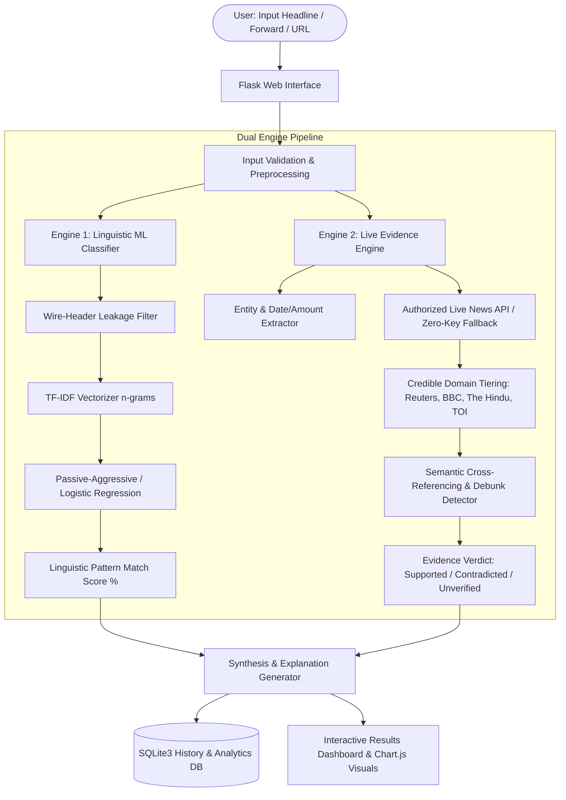

# NewsCheck AI — AI-Powered Fake News Detection & Source Verification System

[](https://www.python.org/)
[](https://palletsprojects.com/p/flask/)
[](https://scikit-learn.org/)
[](LICENSE)

An intelligent, dual-engine fact-checking platform that combines **natural language processing (TF-IDF + Machine Learning)** with **live journalistic source verification** (Reuters, BBC News, The Hindu, The Times of India, and official government registries).

Developed for academic evaluation, research presentations, and real-world disinformation mitigation.

---

## 1. System Architecture



---

## 2. Key Features

- **Dual-Engine Architecture**: Separates statistical linguistic pattern recognition from real-world empirical facts.
- **Wire Leakage Prevention**: Automatically strips wire-agency header patterns (e.g. `WASHINGTON (Reuters) -`) during ML training so the classifier learns genuine syntactic indicators rather than memorizing publisher names.
- **Live Press Aggregation**: Queries accredited news organizations (The Hindu, Times of India, BBC News, Reuters) and official government sources (PIB, ISRO).
- **Ethical Silence Policy**: Adheres to journalistic standards: **A newspaper's silence is never treated as proof of falsity**. Unreported events are classified as *Unverified — insufficient evidence*.
- **Debunk & Hoax Detection**: Explicitly detects fact-checks and debunk notices published by verified newsrooms.
- **Analytics & History**: Interactive SQLite-backed dashboard with Chart.js visualizations (verdict breakdown, confusion matrix, and accuracy metrics).

> [!NOTE]
> **Key Academic Finding:** “The classifier scores about 99.6% on the ISOT test set. This measures how well it separates this dataset’s writing styles, not whether a real-world claim is true. That is why NewsCheck AI adds live evidence-based verification.”

---

## 3. Project Directory Structure

```
Fake news/
├── app.py                      # Flask web application & route handlers
├── train_model.py              # ML training, evaluation & model export
├── requirements.txt            # Python dependencies
├── .env.example                # Example environment variable file
├── .env                        # Local environment configuration
├── .gitignore                  # Git ignore rules
├── dataset/
│   ├── bootstrap_sample.py     # Generates authentic test datasets
│   ├── True.csv                # Authentic news articles
│   └── Fake.csv                # Misleading / fabricated articles
├── database/
│   └── db.py                   # SQLite database manager & statistics
├── models/
│   ├── model.pkl               # Trained Passive-Aggressive classifier
│   ├── vectorizer.pkl          # Fitted TF-IDF vectorizer
│   └── metrics.json            # Model evaluation metrics & confusion matrix
├── services/
│   ├── news_search.py          # NewsAPI & DuckDuckGo news search provider
│   └── verification.py         # Claim extraction & evidence comparison engine
├── templates/
│   ├── base.html               # Base layout, navbar, loader & styling
│   ├── index.html              # Homepage with hero & quick submission
│   ├── analyze.html            # Deep analysis portal with preset claims
│   ├── results.html            # Detailed dual-engine breakdown & citations
│   ├── dashboard.html          # Interactive charts & evaluation metrics
│   ├── history.html            # Analysis audit log with search filter
│   └── about.html              # Methodology, architecture & viva guide
└── static/
    ├── css/
    │   └── style.css           # Dark navy & electric teal design system
    └── js/
        └── app.js              # Interactivity, loader progression & Chart.js
```

---

## 4. Installation & Setup on Windows (VS Code)

### Step 1: Open Project in VS Code
Open VS Code, press `Ctrl + ~` to open the integrated terminal (PowerShell or Command Prompt), and navigate to the project root:
```powershell
cd "c:\Users\anike\OneDrive\Desktop\Fake news"
```

### Step 2: Install Dependencies
Install all required libraries using pip:
```powershell
python -m pip install -r requirements.txt
```

### Step 3: Configure Environment Variables
Copy `.env.example` to `.env`:
```powershell
copy .env.example .env
```
*(Optional)* If you have a free API key from [NewsAPI.org](https://newsapi.org/), paste it into `.env`:
```ini
NEWS_API_KEY=your_key_here
```
> **Note:** If left empty, NewsCheck AI automatically uses the built-in zero-key live news search engine.

---

## 5. Dataset Setup & Model Training

### Option A: Using the Bootstrap Sample Dataset (Ready Immediately)
The system includes an automatic starter dataset generator:
```powershell
python dataset/bootstrap_sample.py
```
This generates balanced sample `True.csv` and `Fake.csv` files covering technology, politics, economics, and common viral hoaxes.

### Option B: Using the Full Kaggle Dataset
1. Download the [Fake and Real News Dataset on Kaggle](https://www.kaggle.com/datasets/clmentbisaillon/fake-and-real-news-dataset).
2. Extract the downloaded zip file.
3. Place `True.csv` and `Fake.csv` directly into the `dataset/` folder:
   - `dataset/True.csv`
   - `dataset/Fake.csv`

### Train the Classifiers
Run the training script to train and benchmark both the **Passive-Aggressive Classifier** and **Logistic Regression**:
```powershell
python train_model.py
```
This will:
- Clean and deduplicate articles.
- Strip wire headers to prevent data leakage.
- Fit the TF-IDF vectorizer on unigrams and bigrams.
- Output Accuracy, Precision, Recall, F1-Score, and Confusion Matrix.
- Save `models/model.pkl`, `models/vectorizer.pkl`, and `models/metrics.json`.

---

## 6. Running the Web Application

Launch the Flask server:
```powershell
python app.py
```

Open your browser and navigate to:
```
http://127.0.0.1:5000
```

---

## 7. College Viva / Presentation Q&A Guide

| Question | Answer Summary |
| :--- | :--- |
| **Why not rely only on ML classification?** | A statistical classifier only learns vocabulary and tone from past data. It cannot know if a real-world event happened this morning. Empirical evidence requires live search in accredited newsrooms. |
| **Why Passive-Aggressive Classifier?** | Passive-Aggressive algorithms are online learning techniques well-suited for high-dimensional, sparse text streams. They remain passive when classification is correct and aggressively update weights when an error occurs. |
| **How did you prevent data leakage?** | Datasets like ISOT have wire headers like *"WASHINGTON (Reuters) -"* on real articles. If uncleaned, the model simply learns that "Reuters" = Real. We implemented regex pre-cleaning to strip all agency prefixes. |
| **How do you handle unindexed news?** | We enforce an ethical rule: **A newspaper's silence is not proof of falsity**. If an item has no matching press articles, it is marked as *Unverified — insufficient evidence*. |
| **What does the 99.6% classifier score signify?** | The classifier scores about 99.6% on the ISOT test set. This measures how well it separates this dataset’s writing styles, not whether a real-world claim is true. That is why NewsCheck AI adds live evidence-based verification. |
