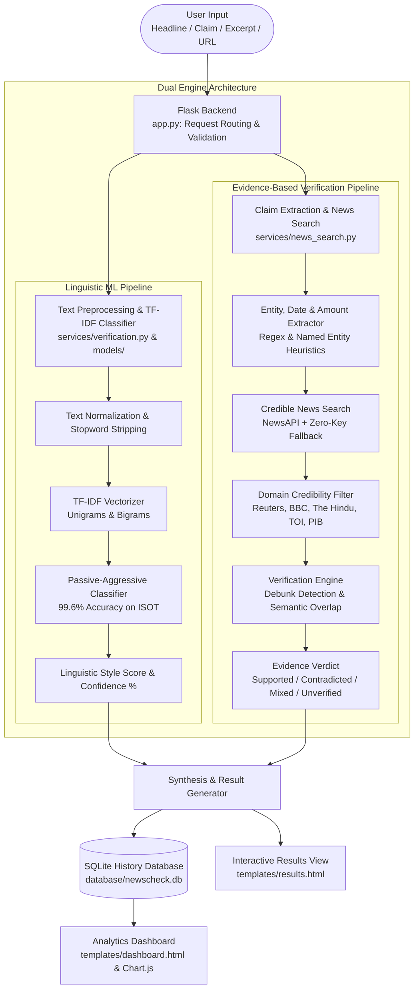

# NewsCheck AI — AI-Powered Fake News Detection & Source Verification System

[](https://www.python.org/)
[](https://palletsprojects.com/p/flask/)
[](https://scikit-learn.org/)
[](LICENSE)

An intelligent, dual-engine fact-checking platform that combines **natural language processing (TF-IDF + Machine Learning)** with **live journalistic source verification** (Reuters, BBC News, The Hindu, The Times of India, and official government registries).

Developed for academic evaluation, research presentations, and real-world disinformation mitigation.

---

## 1. System Architecture



### Component Breakdown

| Component | Responsibility & Implementation |
| :--- | :--- |
| **1. User Input** | Web entry point on `/analyze` or `/` where users paste headlines, WhatsApp forwards, or article excerpts with optional source links. |
| **2. Flask Backend (`app.py`)** | Central controller handling HTTP routing, input validation (rejects empty or `< 15` char inputs), session flashing, and dual-pipeline execution. |
| **3. Text Preprocessing & TF-IDF Classifier** | Cleans text (lowercase, URL removal, punctuation stripping), transforms via fitted TF-IDF unigram/bigram vectorizer, and classifies writing style with the **Passive-Aggressive Classifier** (`models/model.pkl`). |
| **4. Claim Extraction & News Search** | Strips conversational filler and forwarding instructions (`"forwarded as received"`, `"urgent alert"`), isolates named entities, years, and amounts, and queries NewsAPI with a zero-key DuckDuckGo fallback (`services/news_search.py`). |
| **5. Verification Engine** | Evaluates gathered press coverage for debunk tokens (`"fact-check"`, `"hoax"`, `"false"`, `"debunked"`) and token overlap to yield 1 of 4 verdicts: *Supported*, *Contradicted*, *Mixed*, or *Unverified*. Enforces the **Ethical Silence Policy**. |
| **6. SQLite History (`database/db.py`)** | Embedded database (`database/newscheck.db`) storing query text, ML predictions, confidence levels, verification verdicts, source metadata (JSON), and timestamps. |
| **7. Dashboard (`templates/dashboard.html`)** | Interactive analytics portal rendered with Chart.js displaying total verifications, verdict breakdowns, ML distribution, 7-day activity, and model evaluation metrics (accuracy, precision, recall, confusion matrix). |

---

### Step-by-Step Data Flow (College Viva & Presentation Walkthrough)

1. **Ingestion & Validation**: The user submits text on the web interface. The Flask backend validates that the input is non-empty and at least 15 characters long to prevent trivial or invalid queries.
2. **Dual-Engine Forking**: The controller passes the sanitized text simultaneously to **Engine 1 (Linguistic ML)** and **Engine 2 (Evidence Verification)**.
3. **Statistical ML Classification**:
   - The text is stripped of links, normalized, and converted into high-dimensional TF-IDF feature vectors.
   - The Passive-Aggressive classifier predicts whether the writing pattern reflects authentic news reporting or sensational/fabricated discourse.
4. **Claim & Entity Extraction**:
   - The verification engine filters out WhatsApp boilerplate (`"must watch"`, `"share with 10 groups"`).
   - Regex and title-casing heuristics extract key entities (e.g. *ISRO*, *Supreme Court*), years (*2024*), and monetary amounts to form a tight, search-optimized query.
5. **Live News Search & Domain Filtering**:
   - The search engine queries accredited journalistic outlets (Reuters, BBC News, The Hindu, Times of India, official registries).
   - Articles are ranked and filtered against whitelisted credible domains.
6. **Cross-Referencing & Verdict Synthesis**:
   - The engine checks retrieved articles for debunking phrases (hoax, fact-check, baseless).
   - If credible outlets debunk the claim $\rightarrow$ **Contradicted**.
   - If multiple accredited outlets report the facts affirmatively $\rightarrow$ **Supported**.
   - If outlets publish conflicting reports $\rightarrow$ **Mixed**.
   - If no credible reports are found $\rightarrow$ **Unverified — insufficient evidence** (*a newspaper's silence is not proof of falsity*).
7. **Persistence & Presentation**:
   - The complete analysis record is saved to SQLite `submissions`.
   - The user is redirected to the dynamic `/results/<id>` page with side-by-side linguistic and source evidence.
   - The `/dashboard` charts and `/history` audit log update in real-time.

---

## 2. Key Features

- **Dual-Engine Architecture**: Separates statistical linguistic pattern recognition from real-world empirical facts.
- **Wire Leakage Prevention**: Automatically strips wire-agency header patterns (e.g. `WASHINGTON (Reuters) -`) during ML training so the classifier learns genuine syntactic indicators rather than memorizing publisher names.
- **Live Press Aggregation**: Queries accredited news organizations (The Hindu, Times of India, BBC News, Reuters) and official government sources (PIB, ISRO).
- **Ethical Silence Policy**: Adheres to journalistic standards: **A newspaper's silence is never treated as proof of falsity**. Unreported events are classified as *Unverified — insufficient evidence*.
- **Debunk & Hoax Detection**: Explicitly detects fact-checks and debunk notices published by verified newsrooms.
- **Analytics & History**: Interactive SQLite-backed dashboard with Chart.js visualizations (verdict breakdown, confusion matrix, and accuracy metrics).

> [!NOTE]
> **Key Academic Finding:** “The classifier scores about 99.6% on the ISOT test set. This measures how well it separates this dataset’s writing styles, not whether a real-world claim is true. That is why NewsCheck AI adds live evidence-based verification.”

---

## 3. Project Directory Structure

```
Fake news/
├── app.py                      # Flask web application & route handlers
├── train_model.py              # ML training, evaluation & model export
├── requirements.txt            # Python dependencies
├── .env.example                # Example environment variable file
├── .env                        # Local environment configuration
├── .gitignore                  # Git ignore rules
├── dataset/
│   ├── True.csv                # Authentic news articles (Full Kaggle dataset)
│   └── Fake.csv                # Misleading / fabricated articles (Full Kaggle dataset)
├── tools/
│   ├── bootstrap_sample.py     # Isolated starter dataset generator (safe from dataset/)
│   └── sample_data/            # Isolated directory for generated test sample CSVs
├── database/
│   ├── db.py                   # SQLite database manager & statistics
│   └── newscheck.db            # Persistent SQLite database
├── models/
│   ├── model.pkl               # Trained Passive-Aggressive classifier
│   ├── vectorizer.pkl          # Fitted TF-IDF vectorizer
│   └── metrics.json            # Model evaluation metrics & confusion matrix
├── services/
│   ├── news_search.py          # NewsAPI & DuckDuckGo news search provider
│   └── verification.py         # Claim extraction & evidence comparison engine
├── templates/
│   ├── base.html               # Base layout, navbar, loader & styling
│   ├── index.html              # Homepage with hero & quick submission
│   ├── analyze.html            # Deep analysis portal with preset claims
│   ├── results.html            # Detailed dual-engine breakdown & citations
│   ├── dashboard.html          # Interactive charts & evaluation metrics
│   ├── history.html            # Analysis audit log with search filter
│   └── about.html              # Methodology, architecture & viva guide
└── static/
    ├── css/
    │   └── style.css           # Dark navy & electric teal design system
    └── js/
        └── app.js              # Interactivity, loader progression & Chart.js
```

---

## 4. Installation & Setup on Windows (VS Code)

### Step 1: Open Project in VS Code
Open VS Code, press `Ctrl + ~` to open the integrated terminal (PowerShell or Command Prompt), and navigate to the project root:
```powershell
cd "c:\Users\anike\OneDrive\Desktop\Fake news"
```

### Step 2: Install Dependencies
Install all required libraries using pip:
```powershell
python -m pip install -r requirements.txt
```

### Step 3: Configure Environment Variables
Copy `.env.example` to `.env`:
```powershell
copy .env.example .env
```
*(Optional)* If you have a free API key from [NewsAPI.org](https://newsapi.org/), paste it into `.env`:
```ini
NEWS_API_KEY=your_key_here
```
> **Note:** If left empty, NewsCheck AI automatically uses the built-in zero-key live news search engine.

---

## 5. Dataset Setup & Model Training

### Option A: Using the Full Kaggle Dataset (Recommended & Included)
The full dataset of over 44,000 articles is already placed in `dataset/`:
- `dataset/True.csv` (~53.5 MB)
- `dataset/Fake.csv` (~62.8 MB)

### Option B: Generating Isolated Sample Datasets for Quick Testing
The bootstrap utility is located in `tools/bootstrap_sample.py` to ensure it **never accidentally overwrites the real `dataset/True.csv` and `dataset/Fake.csv`**:
```powershell
python tools/bootstrap_sample.py
```
> Samples are generated in `tools/sample_data/` and strictly blocked from touching the authentic `dataset/` directory.

### Train the Classifiers
Run the training script to train and benchmark both the **Passive-Aggressive Classifier** and **Logistic Regression**:
```powershell
python train_model.py
```
This will:
- Clean and deduplicate articles.
- Strip wire headers to prevent data leakage.
- Fit the TF-IDF vectorizer on unigrams and bigrams.
- Output Accuracy, Precision, Recall, F1-Score, and Confusion Matrix.
- Save `models/model.pkl`, `models/vectorizer.pkl`, and `models/metrics.json`.

---

## 6. Running the Web Application

Launch the Flask server:
```powershell
python app.py
```

Open your browser and navigate to:
```
http://127.0.0.1:5000
```

---

## 7. Testing Guide (Test Cases & Expected Results)

Use these 5 standard test cases to demonstrate and validate every major facet of NewsCheck AI during demonstrations, code reviews, and presentations:

| # | Test Scenario | Test Input / Action | System Behavior & Execution Flow | Expected Result |
| :-: | :--- | :--- | :--- | :--- |
| **1** | **Real Headline** *(Authentic News)* | `"ISRO successfully conducts landing experiment of reusable launch vehicle Pushpak"` | 1. Input passes validation.<br>2. Classifier evaluates formal news syntax.<br>3. Extractor queries: `ISRO landing experiment reusable launch vehicle Pushpak`.<br>4. Live news search returns authentic coverage from *The Hindu*, *Times of India*, or *BBC*.<br>5. Overlap > 35% with zero debunk tokens. | **Verdict**: `Supported by available evidence` (Green badge).<br>**Style Score**: High match (~90%+) with authentic news style.<br>**Citations**: Displays linked newsroom articles confirming the test. |
| **2** | **Made-Up Claim** *(Viral Hoax / Debunked)* | `"UNESCO officially declares Indian national anthem Jana Gana Mana as the best anthem in the world"` | 1. Input passes validation.<br>2. Classifier identifies sensational / viral forward linguistic markers.<br>3. Extractor queries: `UNESCO Indian national anthem Jana Gana Mana best`.<br>4. Live search finds fact-checks and debunk articles.<br>5. Debunk tokens detected (`hoax`, `debunked`, `fake`). | **Verdict**: `Contradicted by available evidence` (Red badge).<br>**Summary**: Cites newsrooms/fact-checkers explicitly debunking the viral forward.<br>**Style Score**: High match with sensational / fake pattern style. |
| **3** | **Wrongly Altered Real Claim** *(Subtle Disinformation)* | `"Reserve Bank of India cuts repo rate to 2.5 percent and abolishes all home loan interest"` | 1. Blends legitimate entities (*RBI*, *repo rate*) with fabricated figures (*2.5%*, *abolished interest*).<br>2. Extractor queries: `Reserve Bank India repo rate 2.5 percent`.<br>3. Live search finds genuine RBI reports (rate held at 6.5%), but **none** corroborating a 2.5% cut or interest abolition.<br>4. Ethical silence policy triggers. | **Verdict**: `Unverified — insufficient evidence` (Amber badge).<br>**Summary**: Warns that no credible outlet reports the altered figures, reminding that absence of coverage is not proof of falsity.<br>**Style Score**: Demonstrates why a style score alone cannot detect altered numbers. |
| **4** | **Empty / Too Short Input** *(Validation Boundary)* | Submit an empty input `""` or a short string like `"Breaking news"` | 1. Flask backend intercepts submission in `app.py`.<br>2. Validation rejects empty string or text `< 15` characters.<br>3. Halts execution before model inference or external search to conserve resources. | **Result**: Page reloads gracefully with a Flash warning:<br>`"Please enter a news headline, article excerpt, or claim to analyze."`<br>or `"Input text is too short..."`.<br>No database record created. |
| **5** | **Clear History** *(Database & State Reset)* | Navigate to `/history` and click the **"Clear History"** button | 1. Sends `POST` request to `/history/clear`.<br>2. Flask executes SQL `DELETE FROM submissions` in `db.py`.<br>3. Flash message generated and user redirected to `/history`. | **Result**: Green notification banner:<br>`"Analysis history has been successfully cleared."`<br>History table displays empty state.<br>Dashboard counter resets total submissions to 0. |

---

## 8. College Viva / Presentation Q&A Guide

| Question | Answer Summary |
| :--- | :--- |
| **Why not rely only on ML classification?** | A statistical classifier only learns vocabulary and tone from past data. It cannot know if a real-world event happened this morning. Empirical evidence requires live search in accredited newsrooms. |
| **Why is the classifier's percentage labeled as a “Style Score” instead of a probability?** | The classifier's percentage is a margin distance in TF-IDF vector space mapped via a sigmoid function. It measures stylistic resemblance to the training corpus, not a true Bayesian probability that an event happened. Sophisticated fake news can use formal journalistic prose, which is why truth is determined by the live evidence engine. |
| **Why Passive-Aggressive Classifier?** | Passive-Aggressive algorithms are online learning techniques well-suited for high-dimensional, sparse text streams. They remain passive when classification is correct and aggressively update weights when an error occurs. |
| **How did you prevent data leakage?** | Datasets like ISOT have wire headers like *"WASHINGTON (Reuters) -"* on real articles. If uncleaned, the model simply learns that "Reuters" = Real. We implemented regex pre-cleaning to strip all agency prefixes. |
| **How do you handle unindexed news?** | We enforce an ethical rule: **A newspaper's silence is not proof of falsity**. If an item has no matching press articles, it is marked as *Unverified — insufficient evidence*. |
| **What does the 99.6% classifier score signify?** | The classifier scores about 99.6% on the ISOT test set. This measures how well it separates this dataset’s writing styles, not whether a real-world claim is true. That is why NewsCheck AI adds live evidence-based verification. |
